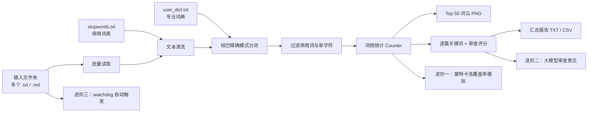
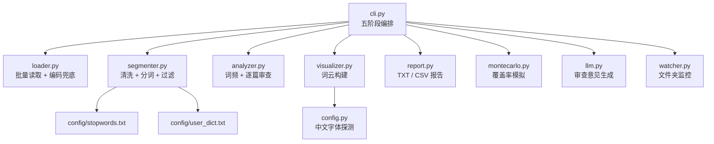
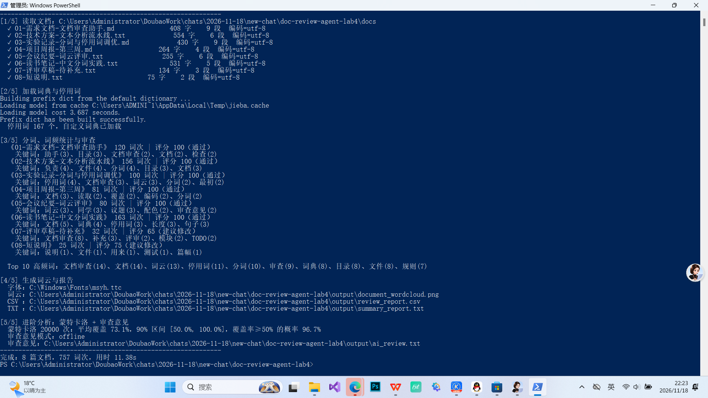
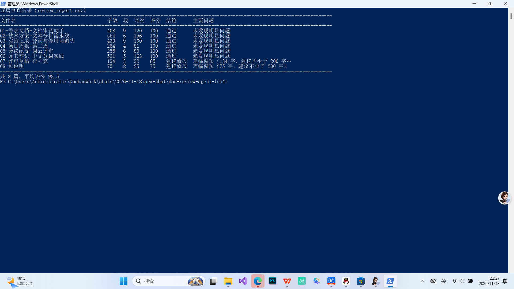
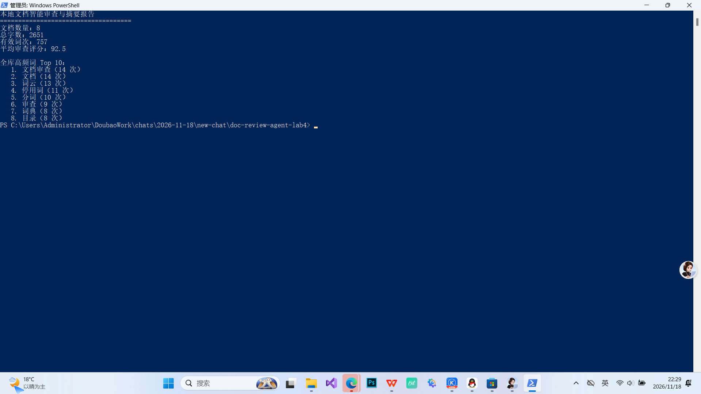
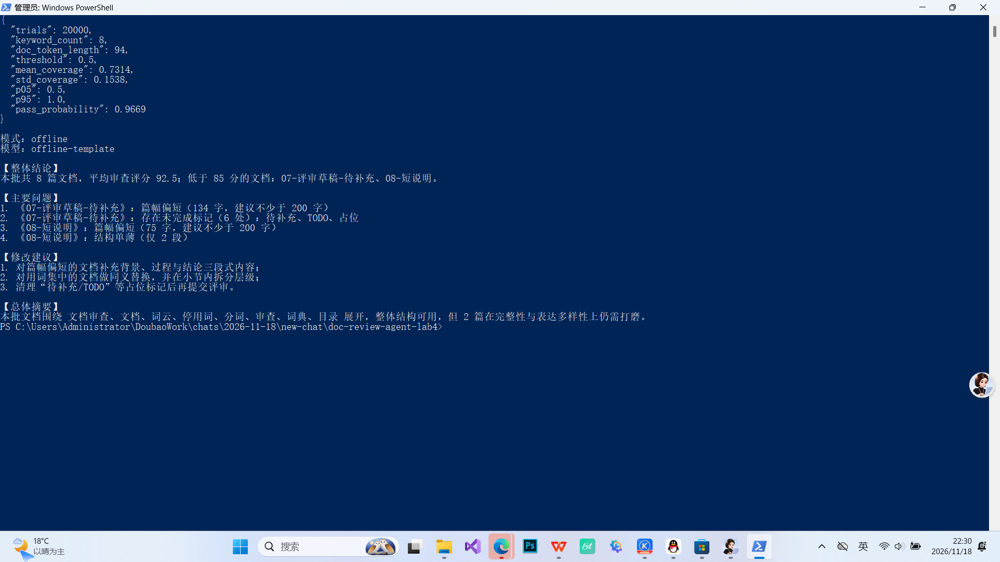
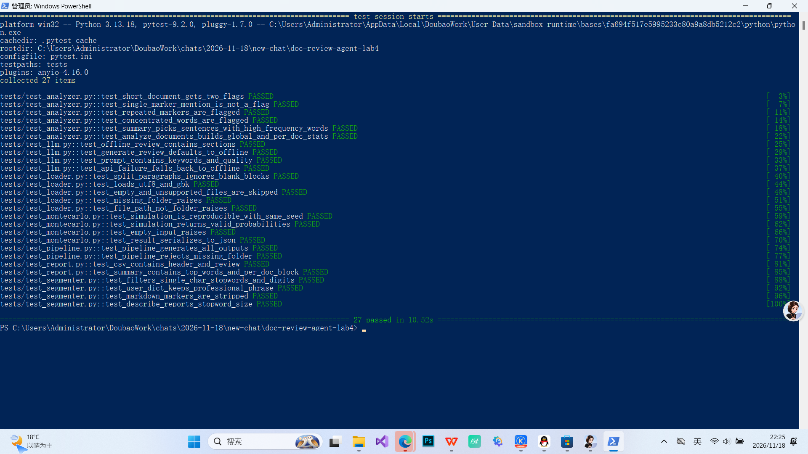
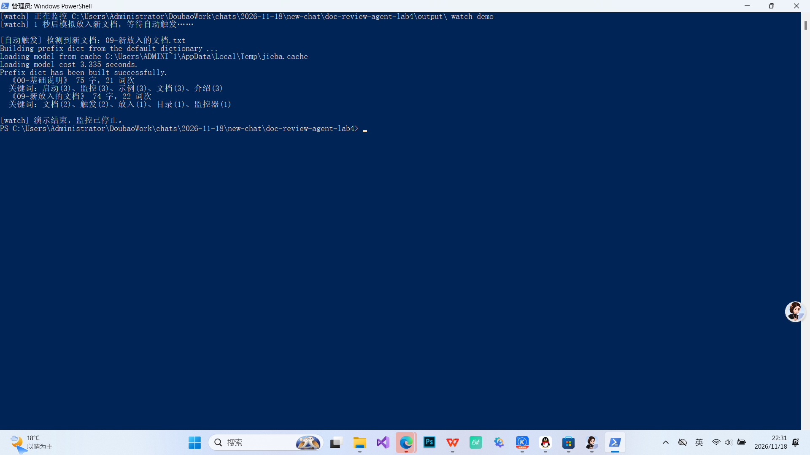
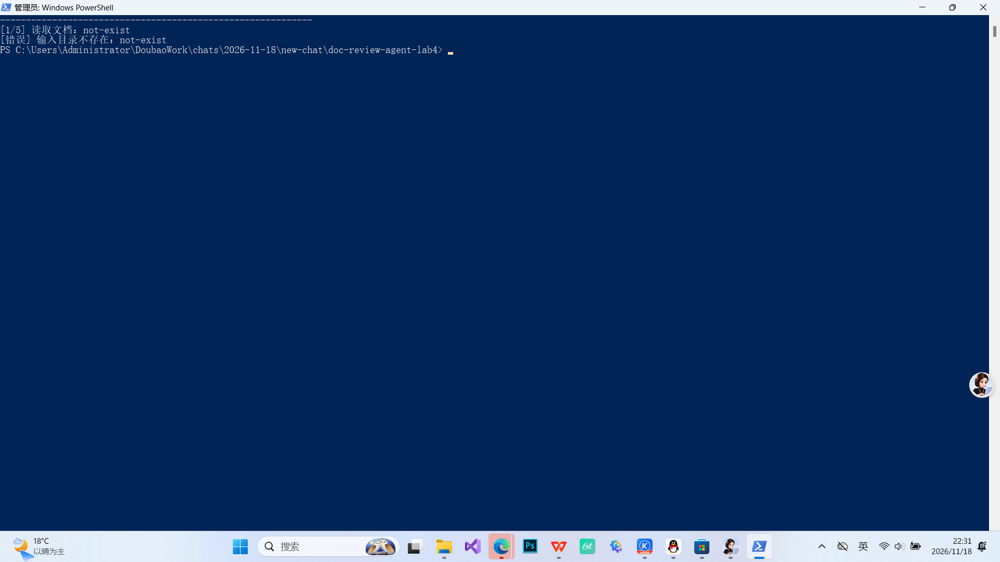

# 从 8 篇文档到一张词云：用 Python 搭一个本地文档智能审查与摘要工具

> 实验主题：本地文档智能审查与摘要
> 技术栈：Python 3.13 + jieba + wordcloud + matplotlib + watchdog + pytest
> 仓库地址：<https://github.com/Hanna2126/doc-review-agent-lab4>
> 关键词：中文分词、停用词、自定义词典、词云、文档审查、蒙特卡洛、watchdog

---

## 一、为什么要做这个工具

手头有一批需求文档、技术方案、周报、会议纪要和评审草稿，真正让人头疼的不是“写”，而是“看”：

- 文档散落在同一个文件夹里，格式有 `.md` 也有 `.txt`，编码还可能是 UTF-8、GBK；
- 想知道这批材料到底在反复讲什么，只能一篇篇翻；
- 想知道哪几篇还没写完、篇幅太短、结构单薄，只能靠人肉判断；
- 想把“高频主题”和“单篇关键词”同时留下来，供后续复盘。

所以这个实验的目标很明确：**给一个文档文件夹，自动完成批量读取、清洗、分词、词频统计、词云生成和逐篇审查，最后输出一份能直接看的汇总报告。**

它不是一个“调用大模型聊两句”的玩具，而是一条可复现、可测试、可无人值守的本地文本处理流水线。

---

## 二、需求边界：先画清楚输入、处理、输出

实验指导书给的需求边界非常清晰，我把它整理成一张流程图：



拆开看就是三件事：

| 维度 | 具体要求 |
|---|---|
| 输入 | 一个包含多个 `.txt` / `.md` 的文件夹；停用词表；专业词典 |
| 处理 | 批量读取 → 文本清洗 → 加载词典与停用词 → jieba 精确模式分词 → 过滤停用词和单字符 → 词频统计 |
| 输出 | Top 50 高频词云 PNG；含各文件核心关键词的汇总报告 TXT / CSV |
| 约束 | 文件不存在、编码错误要有异常处理；中文字体必须正常显示，不能出现方框 |

指导书还给了三个进阶方向：蒙特卡洛模拟、对接大模型 API 生成审查意见/摘要、watchdog 监控文件夹自动触发。这三个我都做了，并且都保留了“没有外部依赖也能跑”的降级路径。

---

## 三、整体设计：一条五阶段流水线

工程没有把逻辑全塞进一个 `main()`，而是按职责拆成模块，`cli.py` 只负责编排：



| 模块 | 职责 | 关键设计 |
|---|---|---|
| `src/loader.py` | 遍历目录、读取文本、切分段落 | 依次尝试 UTF-8、UTF-8-SIG、GBK、GB18030；单文件失败只记录错误，不中断整批 |
| `src/segmenter.py` | 文本清洗、加载词典、精确模式分词 | 过滤长度小于 2 的词、纯符号、纯数字、停用词；支持自定义专业词 |
| `src/analyzer.py` | 全局词频、逐篇关键词、规则审查 | 评分 100 分制，按篇幅、段落、主题集中度、风险标记、Markdown 结构扣分 |
| `src/visualizer.py` | 生成词云 | 必须显式传入中文字体；`collocations=False` 避免把词组拼成伪词 |
| `src/report.py` | 输出 CSV 与 TXT | CSV 用 `utf-8-sig`，Excel 直接打开不乱码 |
| `src/montecarlo.py` | 关键词覆盖率不确定性模拟 | 二项分布抽样，输出均值、标准差、P05/P95 和达标概率 |
| `src/llm.py` | 生成结构化审查意见 | 优先调用 OpenAI 兼容接口，失败自动回退离线模板 |
| `src/watcher.py` | 新增文档自动触发 | created/modified 双事件 + 1 秒防抖，跳过临时文件 |

这样拆的好处很直接：每个模块都能单独写单元测试，出问题时也知道该看哪一层。

---

## 四、关键实现

### 4.1 批量读取：编码不能靠猜，要靠兜底

Windows 上的 `.txt` 经常是 GBK，`.md` 多半是 UTF-8，硬编码一种必然翻车。读取逻辑做成候选编码链：

```python
ENCODINGS = ("utf-8", "utf-8-sig", "gbk", "gb18030")

def _read_text(path: Path) -> tuple[str, str]:
    last_error: Exception | None = None
    for encoding in ENCODINGS:
        try:
            return path.read_text(encoding=encoding), encoding
        except (UnicodeDecodeError, LookupError) as exc:
            last_error = exc
    raise UnicodeDecodeError(
        "utf-8", b"", 0, 1, f"无法用候选编码读取：{last_error}"
    )
```

再配一层目录校验：目录不存在抛 `FileNotFoundError`，路径是文件抛 `NotADirectoryError`，单个文件读失败则写入 `errors` 列表继续跑。**批量任务的原则是：一篇坏文档不能拖垮整批。**

### 4.2 中文分词：词典、停用词、清洗三件套

jieba 的默认词典对“文档审查”“停用词”“词云生成”这类专业词切得很碎，必须加载自定义词典；同时 `.md` 里的 `#`、`*`、反引号、表格竖线也会被当成词，所以分词前先清洗：

```python
PUNCT_ONLY = re.compile(r"^[\W_]+$")
MARKDOWN_NOISE = re.compile(r"[#*`>|_~\[\]()]")

def cut(self, text: str) -> list[str]:
    cleaned = MARKDOWN_NOISE.sub(" ", text)
    tokens = []
    for word in jieba.lcut(cleaned):
        word = word.strip()
        if len(word) < 2:
            continue
        if PUNCT_ONLY.match(word) or word.isdigit():
            continue
        if word.lower() in self.stopwords:
            continue
        tokens.append(word)
    return tokens
```

停用词表 167 个，除了“的、了、和”这类常规词，还补了“这是、一篇、用于”等文档里的高频噪声词。自定义词典 20 多个专业词，保证“文档审查”“蒙特卡洛”“无人值守”不会被切开。

### 4.3 词云：中文字体是硬约束

`wordcloud` 默认字体不带中文，不指定 `font_path` 就是一片方框。工程里做了字体探测，按微软雅黑、黑体、宋体、苹方、文泉驿的顺序找第一个存在的字体：

```python
FONT_CANDIDATES = (
    r"C:\Windows\Fonts\msyh.ttc",
    r"C:\Windows\Fonts\msyh.ttf",
    r"C:\Windows\Fonts\simhei.ttf",
    r"C:\Windows\Fonts\simsun.ttc",
    "/System/Library/Fonts/PingFang.ttc",
    "/usr/share/fonts/truetype/wqy/wqy-microhei.ttc",
)

wordcloud = WordCloud(
    font_path=font_path,
    width=1000,
    height=800,
    background_color="white",
    max_words=50,
    collocations=False,
    prefer_horizontal=0.9,
    margin=6,
    colormap="viridis",
).generate_from_frequencies(frequencies)
```

这里有两个容易踩的点：

1. `max_words=50` 只保留 Top 50，和需求一致；
2. `collocations=False` 必须开，否则 `wordcloud` 会自动把相邻词组成“文档审查文档”这种伪短语，词云会失真。

### 4.4 逐篇审查：把“感觉不对”翻译成扣分规则

审查不是让模型自由发挥，而是一套可解释的规则，每篇文档从 100 分开始扣：

| 检查项 | 规则 | 扣分 |
|---|---|---|
| 篇幅过短 | 有效字数 < 200 | -15 |
| 结构单薄 | 段落数 < 3 | -10 |
| 主题过于集中 | Top1 关键词占比 > 30% | -10 |
| 未完成标记 | “待补充 / TODO / 未完成 / 占位 / 待定 / 存疑”出现 ≥ 2 次 | -20 |
| Markdown 缺标题 | `.md` 文件没有 `#` 标题 | -5 |

结论映射：`≥85` 通过，`≥65` 建议修改，否则需要重写。

风险标记这里有个真实教训：最初只要出现 1 次就扣 20 分，结果技术方案里正常描述“TODO 标记的处理规则”被误判成未完成文档。后来改成**出现 2 次及以上才扣分**，误报才消掉。规则审查的重点不是“抓到一个词就定罪”，而是控制误报。

### 4.5 进阶一：蒙特卡洛模拟关键词覆盖率

如果只从 8 篇文档里抽 8 个关键词，换一批文档，覆盖率还稳吗？用蒙特卡洛回答：

- 每个关键词被抽中的概率 `p = 词频 / 总词次`；
- 每轮抽 `doc_token_length` 个词（模拟一篇文档的长度）；
- 统计这一轮里“至少出现一次”的关键词比例，作为覆盖率；
- 重复 20000 次，得到均值、标准差、P05/P95 和覆盖率 ≥ 50% 的概率。

```python
hits = rng.binomial(doc_token_length, probs)  # 每个关键词出现次数
covered = int((hits > 0).sum())
coverage = covered / keyword_count
```

这次运行的结果：平均覆盖率 **73.14%**，90% 区间 **[50%, 100%]**，覆盖率达到 50% 的概率 **96.69%**。也就是说，这套关键词在同类文档上的代表性是够用的，但仍有约 3% 的概率低于一半。

### 4.6 进阶二：大模型审查意见，可离线降级

`llm.py` 会把 Top 50 关键词、词频、核心文本片段组织成结构化 Prompt，要求模型输出四段：整体结论、主要问题、修改建议、总体摘要。

有 `LLM_BASE_URL` / `LLM_API_KEY` / `LLM_MODEL` 时走 OpenAI 兼容接口；没有密钥或请求失败时，自动回退到离线模板，并在结果里标注 `offline`，不会因为网络问题让整条流水线崩掉。这也是本地工具该有的姿态：**外部服务是增强项，不是单点依赖。**

### 4.7 进阶三：watchdog 无人值守

`watcher.py` 监控文件夹的 `created` 和 `modified` 事件，加 1 秒防抖，跳过 `~$` 临时文件和不支持的扩展名。新文档放进去，自动跑一遍分析并打印关键词。

`scripts/demo_watch.py` 做了一个可复现的演示：启动监控 → 1 秒后写入一篇新文档 → 回调触发 → 打印新文档的字数、词次和关键词。这样不用真的守着文件夹，也能验证“无人值守”这条路是通的。

---

## 五、真实运行结果

以下截图全部来自本机 Windows PowerShell 的真实运行，不是示意图。

### 5.1 完整流水线

```powershell
python cli.py
```



8 篇文档全部读取成功，合计 2651 字、757 个有效词次，冷启动（含 jieba 首次加载）用时 11.38 秒，热缓存约 5.36 秒。五阶段分别为读取、分词、分析、词云、报告，每一步都有明确输出。

### 5.2 Top 50 中文词云


词云为 1000×800 白底，中文显示正常，没有方框。最大的三个词是“文档审查”“文档”“词云”，和这批材料的主题完全吻合。

### 5.3 逐篇审查表



| 文档 | 字数 | 段落 | 词次 | 评分 | 结论 |
|---|---:|---:|---:|---:|---|
| 01 需求文档 | 408 | 9 | 120 | 100 | 通过 |
| 02 技术方案 | 554 | 6 | 156 | 100 | 通过 |
| 03 实验记录 | 430 | 9 | 100 | 100 | 通过 |
| 04 项目周报 | 264 | 4 | 81 | 100 | 通过 |
| 05 会议纪要 | 255 | 6 | 80 | 100 | 通过 |
| 06 读书笔记 | 531 | 5 | 163 | 100 | 通过 |
| 07 评审草稿 | 134 | 3 | 32 | 65 | 建议修改 |
| 08 短说明 | 75 | 2 | 25 | 75 | 建议修改 |

平均分 92.5。07 被判低分是因为只有 134 字，并且出现了 6 处“待补充 / TODO / 占位”；08 则是篇幅 75 字、只有 2 段，属于典型的“内容还没展开”。

### 5.4 汇总报告



TXT 报告包含文档数、总字数、有效词次、平均分、Top10 高频词，以及每篇的关键词、摘要、评分和问题。CSV 版本用 `utf-8-sig` 编码，Excel 双击打开不会乱码。

### 5.5 蒙特卡洛与审查意见



JSON 中记录了 20000 次模拟的完整统计量：`mean=0.7314`、`std=0.1538`、`p05=0.5`、`p95=1.0`、`pass_probability=0.9669`；右侧是离线模式生成的四段式审查意见。

### 5.6 单元测试



27 条用例覆盖读取、分词、分析、蒙特卡洛、报告、端到端流水线和 LLM 降级，全部通过，用时 10.52 秒。

### 5.7 watchdog 自动触发



监控目录启动后 1 秒放入 `09-新放入的文档.txt`，立刻触发 `[自动触发] 检测到新文档`，并输出新文档的 74 字、22 词次和关键词“文档 / 触发 / 放入 / 目录 / 监控器”。

### 5.8 异常处理



传入不存在的目录时，程序打印 `[错误] 输入目录不存在：not-exist`，退出码为 1。异常被收敛在入口层，不会甩出一整屏 traceback。

---

## 六、踩坑记录

| 现象 | 原因 | 解决 |
|---|---|---|
| 词云全是方框 | `wordcloud` 默认字体不含中文 | 显式传 `font_path`，按候选列表探测 `msyh.ttc` 等中文字体 |
| 词云出现“文档审查文档”这类怪词 | `collocations` 默认会把相邻词组成二元短语 | 设 `collocations=False`，只按词频生成 |
| jieba 在 Python 3.13 报警告 | 源码中的转义序列触发 `SyntaxWarning` | 入口处过滤 `SyntaxWarning`，`pytest.ini` 同步配置 |
| 07 文档只提了一次 TODO 就被重罚 | 风险标记规则过严，描述规则本身也会命中 | 改为出现 ≥ 2 次才扣分，降低误报 |
| Markdown 符号混进词频 | `#`、`*`、反引号、表格竖线被 jieba 当成词 | 分词前用正则清洗 Markdown 噪声 |
| Windows 终端读 UTF-8 文件乱码 | Windows PowerShell 5.1 默认按本地编码读无 BOM 文件 | `Get-Content -Encoding UTF8`，Python 侧统一 `utf-8-sig` 输出 |
| watchdog 一次写入触发多次 | 编辑器保存会产生多个事件 | 1 秒防抖 + 记录最近处理时间，跳过 `~$` 临时文件 |

---

## 七、测试与工程化

测试按模块切分，不追求“覆盖率数字好看”，而是覆盖真实会出问题的地方：

- `test_loader.py`：正常读取、GBK 兜底、空文件跳过、目录不存在、路径是文件；
- `test_segmenter.py`：停用词过滤、单字符过滤、专业词典生效、Markdown 清洗；
- `test_analyzer.py`：评分边界、风险标记阈值、摘要长度、空文档；
- `test_montecarlo.py`：统计量范围、固定随机种子的可复现性；
- `test_report.py`：CSV 表头与编码、TXT 关键字段；
- `test_pipeline.py`：端到端产物齐全、缺目录时退出码为 1；
- `test_llm.py`：无密钥回退、接口失败回退、Prompt 结构。

```bash
python -m pytest -v
# 27 passed in 10.52s
```

---

## 八、如何复现

```bash
git clone https://github.com/Hanna2126/doc-review-agent-lab4.git
cd doc-review-agent-lab4
python -m pip install -r requirements.txt

# 完整流水线
python cli.py

# 查看对齐后的审查表
python scripts/show_report.py

# 运行测试
python -m pytest -v

# 演示 watchdog 自动触发
python scripts/demo_watch.py
```

默认输入目录是 `docs/`，输出目录是 `output/`，也可以显式指定：

```bash
python cli.py --input docs --output output --top 50
```

如果要接大模型，设置三个环境变量即可；不设置则自动走离线审查模板：

```bash
set LLM_BASE_URL=https://your-endpoint/v1
set LLM_API_KEY=your-key
set LLM_MODEL=your-model
```

---

## 九、小结

这个实验表面上在做“词云”，真正练的是四件事：

1. **批量处理的健壮性**：编码、坏文件、空目录，任何一个都不能让整批任务停摆；
2. **中文文本处理的细节**：词典决定分词质量，停用词决定词频是否干净，清洗决定词云是否可读；
3. **可解释的审查**：评分规则要写清楚，误报要能通过阈值调整压下去；
4. **增强能力的降级设计**：蒙特卡洛、大模型、watchdog 都是加分项，但没有网络、没有密钥时，主流程仍然要能跑完。

从 8 篇文档到一张词云，中间其实是一条完整的文本工程链路。把每一层拆开、测到、记录下来，比单纯“生成一张好看的图”更有价值。
